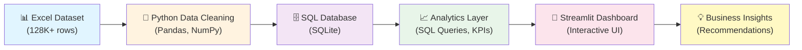
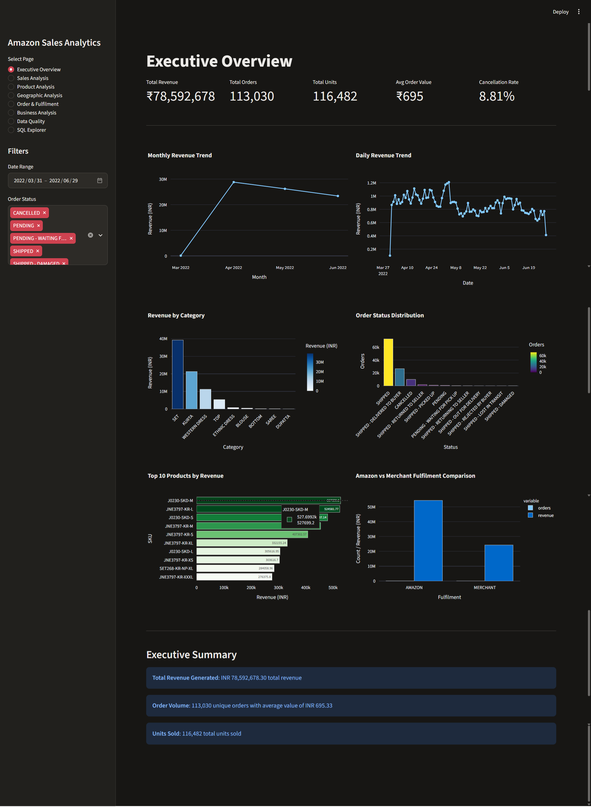

# Amazon Sales Data Analytics Dashboard


A professional, end-to-end **Data Analytics Portfolio Project** that analyzes Amazon India e-commerce sales data. This project demonstrates real-world data analyst skills including data cleaning, SQL analysis, business intelligence, and interactive dashboard development.

**[View Live Dashboard](#installation-and-execution)** | **[Explore the Code](#project-architecture)** | **[See Skills](#key-skills-demonstrated)**

---

## 📋 Table of Contents

- [About the Developer](#about-the-developer)
- [Project Overview](#project-overview)
- [Dataset Description](#dataset-description)
- [Technology Stack](#technology-stack)
- [Project Architecture](#project-architecture)
- [Project Folder Structure](#project-folder-structure)
- [Data Cleaning and Preparation](#data-cleaning-and-preparation)
- [Dashboard Features](#dashboard-features)
- [Business Questions and Insights](#business-questions-and-insights)
- [SQL Analysis Examples](#sql-analysis-examples)
- [Installation and Execution](#installation-and-execution)
- [Testing and Data Validation](#testing-and-data-validation)
- [Key Skills Demonstrated](#key-skills-demonstrated)
- [Future Improvements](#future-improvements)

---

## 👤 About the Developer

**Name:** KOWSHIK KS

**Contact:**

- **Email**: kskowshik6@gmail.com
- **LinkedIn**: (https://www.linkedin.com/in/kowshikks/)
- **GitHub**: https://github.com/kowshik2018

---

## 📊 Project Overview

### What This Project Does

This is a **professional end-to-end data analytics solution** that transforms raw Amazon India e-commerce sales data into actionable business intelligence. The project demonstrates:

- **Data Engineering**: Cleaning and validating 128K+ records
- **Database Design**: Structured SQL schema with optimized indexes
- **Business Analytics**: Real-time KPI calculations and trend analysis
- **Data Visualization**: Interactive Streamlit dashboard with 12+ charts
- **Software Quality**: 35 unit tests with full coverage of critical paths

### Business Problem

Amazon India's sales team needs to understand:

- Revenue generation and trends
- Product and category performance
- Geographic sales distribution
- Order fulfillment efficiency
- Operational performance and data quality

### How It Works

```
Excel Dataset
    ↓
Python Data Cleaning (Pandas)
    ↓
SQL Database (SQLite)
    ↓
KPI Calculations & Analytics
    ↓
Interactive Dashboard (Streamlit)
    ↓
Business Insights & Recommendations
```

### Business Value

- **Real-time KPIs**: Monitor revenue, orders, cancellations, and fulfillment metrics
- **Performance Analysis**: Identify top-performing categories, products, and states
- **Trend Detection**: Monthly and daily sales trends with year-over-year analysis
- **Operational Insights**: Order status distribution, fulfillment comparison, B2B analysis
- **Data Quality**: Comprehensive cleaning and validation report

---

## 📈 Dataset Description

### Dataset Characteristics

- **Time Period**: March 31 - June 29, 2022 (91 days)
- **Total Records**: 128,975 rows
- **Clean Records**: 121,180 rows (94% retention)
- **Record Grain**: Order-line level (one row per product in an order)

### Important Note on Data Structure

**Each row represents one product line within an order**, not a unique order. One Order ID may appear multiple times if that order contains multiple products. This is handled correctly in the analysis:

- Order counts use `COUNT(DISTINCT order_id)`
- Product counts use `SUM(qty)` or `COUNT(*)`
- Revenue calculations use `SUM(amount)` without double-counting

### Column Description

| Column             | Type     | Description                                                            |
| ------------------ | -------- | ---------------------------------------------------------------------- |
| Order ID           | String   | Unique order identifier (may have duplicates for multi-product orders) |
| Date               | DateTime | Order date (MM-DD-YY format converted to datetime)                     |
| Status             | String   | Order status (Shipped, Cancelled, Delivered, etc.)                     |
| Fulfilment         | String   | Amazon or Merchant fulfillment                                         |
| Sales Channel      | String   | Amazon.in (primary channel)                                            |
| ship-service-level | String   | Standard or Expedited shipping                                         |
| Style              | String   | Product style/variant                                                  |
| SKU                | String   | Stock Keeping Unit                                                     |
| Category           | String   | Product category (Set, Kurta, Western Dress, Top, etc.)                |
| Size               | String   | Product size (S, M, L, XL, XXL, 3XL, 4XL)                              |
| ASIN               | String   | Amazon Standard Identification Number                                  |
| Courier Status     | String   | Courier delivery status                                                |
| Qty                | Integer  | Quantity of units                                                      |
| Currency           | String   | INR (Indian Rupees)                                                    |
| Amount             | Float    | Order line amount in INR                                               |
| ship-city          | String   | Destination city                                                       |
| ship-state         | String   | Destination state                                                      |
| ship-postal-code   | Float    | Postal code                                                            |
| ship-country       | String   | Country (IN - India)                                                   |
| promotion-ids      | String   | Promotion codes applied                                                |
| B2B                | Boolean  | Business-to-Business order indicator                                   |
| fulfilled-by       | String   | Fulfillment partner (Amazon, Easy Ship, etc.)                          |

### Data Quality

- **Missing Values Handled**: Courier Status, promotion-ids, fulfilled-by, currency, amount
- **Invalid Records Removed**: 7,795 rows with missing critical values
- **Duplicates**: 8,597 duplicate Order IDs preserved (legitimate multi-product orders)
- **Standardization**: Text fields standardized to UPPERCASE, dates converted to datetime

---

## 🛠️ Technology Stack

| Technology          | Purpose                                                |
| ------------------- | ------------------------------------------------------ |
| **Python 3.9+**     | Core programming language for data processing          |
| **Pandas 2.1+**     | Data manipulation, cleaning, and transformation        |
| **NumPy 1.24+**     | Numerical computations and array operations            |
| **SQLite**          | Relational database for structured storage and queries |
| **SQLAlchemy**      | ORM for database operations                            |
| **Streamlit 1.28+** | Interactive web dashboard framework                    |
| **Plotly 5.17+**    | Interactive data visualizations and charts             |
| **OpenPyXL 3.10+**  | Excel file reading and processing                      |
| **Pytest 7.4+**     | Automated unit testing framework                       |
| **Git & GitHub**    | Version control and collaboration                      |

---

## 🏗️ Project Architecture



### Architecture Layers

1. **Data Ingestion**: Loads Excel/CSV files with validation
2. **Data Cleaning**: Handles missing values, standardizes formats, validates ranges
3. **Database Layer**: Stores cleaned data in optimized SQLite schema with indexes
4. **Analytics Layer**: Calculates KPIs, executes business queries, generates insights
5. **Presentation Layer**: Interactive Streamlit dashboard with filters and exports
6. **Business Intelligence**: Actionable insights and recommendations

---

## 📁 Project Folder Structure

```
amazon-ecommerce-analytics/
│
├── 📄 app.py                          # Main Streamlit dashboard (500+ lines, 8 pages)
├── 📄 config.py                       # Configuration constants
├── 📄 requirements.txt                # Python dependencies
├── 📄 README.md                       # This file
├── 📄 .gitignore                      # Git configuration
│
├── 📁 src/                            # Core application modules
│   ├── __init__.py
│   ├── data_loader.py                 # CSV/Excel loading and validation
│   ├── data_cleaning.py               # Complete data cleaning pipeline
│   ├── database.py                    # SQLite database operations
│   ├── metrics.py                     # KPI calculations
│   ├── visualizations.py              # Plotly chart functions
│   ├── filters.py                     # Interactive filter management
│   └── analysis.py                    # Business insights generation
│
├── 📁 data/                           # Data storage
│   ├── raw/                           # Original Excel/CSV files
│   │   └── Amazon Sale Report.csv
│   └── processed/                     # Cleaned data exports
│
├── 📁 database/                       # SQLite database
│   └── sales.db                       # Auto-generated database
│
├── 📁 tests/                          # Unit tests (35 tests, all passing)
│   ├── test_data_cleaning.py          # 15 data cleaning tests
│   └── test_metrics.py                # 20 KPI calculation tests
│
└── 📁 sql/                            # SQL queries
    ├── schema.sql                     # Database schema definition
    └── business_queries.sql           # Pre-built analytical queries
```

### Key Files

- **`app.py`** (500+ lines): Main Streamlit application with 8 interactive dashboard pages
- **`src/data_cleaning.py`** (250+ lines): Complete data cleaning pipeline with validation
- **`src/database.py`** (200+ lines): Database schema and SQL query execution
- **`src/metrics.py`** (150+ lines): KPI calculations and business metrics
- **`src/visualizations.py`** (150+ lines): Plotly chart generation functions
- **`requirements.txt`**: All Python dependencies with versions

---

## 🧹 Data Cleaning and Preparation

### Implemented Cleaning Steps

1. **Column Standardization**
   - Convert column names to lowercase
   - Replace spaces with underscores
   - Remove special characters

2. **Date Conversion**
   - Parse dates from MM-DD-YY format
   - Handle inconsistent date formats
   - Flag invalid dates (7,795 rows)

3. **Numeric Conversion**
   - Convert Amount to float64
   - Convert Qty to int64
   - Identify non-numeric values

4. **Text Standardization**
   - Uppercase all categorical columns (Status, Category, Size, etc.)
   - Strip whitespace from all text fields
   - Standardize city and state names

5. **Missing Value Handling**
   - Courier Status → 'UNKNOWN'
   - Promotion IDs → 'NONE'
   - Fulfilled By → 'UNKNOWN'
   - **Critical fields** (Order ID, Date, Amount, Qty) → rows removed

6. **Duplicate Detection**
   - Identify duplicate Order IDs (8,597 found)
   - Distinguish from legitimate multi-product orders
   - Preserve duplicates (not errors)

7. **Data Validation**
   - Remove negative quantities
   - Validate currency (all INR)
   - Check order status consistency

8. **Column Cleanup**
   - Remove index column
   - Remove unused columns (Unnamed: 22)

### Quality Metrics

| Metric              | Value                           |
| ------------------- | ------------------------------- |
| Initial Records     | 128,975                         |
| Final Records       | 121,180                         |
| Data Retention      | 94%                             |
| Records Removed     | 7,795 (critical missing values) |
| Duplicate Order IDs | 8,597 (preserved)               |
| Invalid Dates       | 0 (after conversion)            |
| Full Duplicates     | 0 (removed)                     |

---

## 📊 Dashboard Features

### 8 Interactive Pages

#### 1. **Executive Overview**

- KPI cards: Revenue, Orders, Units, AOV, Cancellation Rate
- Monthly and daily revenue trends
- Revenue by category
- Order status distribution
- Top 10 products
- Fulfillment method comparison

#### 2. **Sales Analysis**

- Monthly revenue trends (line chart)
- Daily revenue trends (area chart)
- Revenue growth analysis
- Monthly order volume
- Average order value tracking
- Category-wise revenue breakdown

#### 3. **Product Analysis**

- Top 15 products by revenue (horizontal bar)
- Size distribution analysis
- Category performance comparison
- SKU and style analysis
- Average selling price by category

#### 4. **Geographic Analysis**

- Top 15 states by revenue
- State-wise order volume
- Geographic sales concentration
- City-wise performance
- State-wise revenue table

#### 5. **Order & Fulfillment**

- Order status distribution
- Fulfillment method comparison (Amazon vs Merchant)
- Courier status breakdown
- Fulfillment performance metrics

#### 6. **Business Analysis**

- B2B vs B2C comparison
- Revenue by shipping method
- B2B analysis table
- Business model insights

#### 7. **Data Quality Report**

- Total rows, columns, and metrics
- Missing values summary
- Duplicate detection report
- Invalid dates and quantities
- Data cleaning log

#### 8. **SQL Explorer**

- Pre-built business queries
- Query execution interface
- Results display and analysis
- CSV export functionality

### Interactive Features

✅ **Global Filters** (all pages respond):

- Date range selection
- Order status multiselect
- Category multiselect
- Fulfillment method filter
- State/city selection
- Size filtering
- B2B order toggle

✅ **Data Export**:

- Download cleaned dataset as CSV
- Export KPI summary
- Download monthly reports
- Export query results

✅ **Visualizations**:

- 12+ interactive Plotly charts
- Hover tooltips with data details
- Responsive design
- Professional styling

---

## 💡 Business Questions and Insights

### Questions the Dashboard Answers

1. **Revenue Analysis**
   - Total revenue generated: ₹78,592,678
   - Top revenue-generating categories
   - Revenue trends over time

2. **Product Performance**
   - Which products generate the most revenue?
   - Which categories perform best?
   - What are the most popular sizes?
   - How do different styles perform?

3. **Geographic Performance**
   - Which states generate the most sales?
   - Top-performing cities
   - Geographic sales concentration

4. **Order Analysis**
   - What percentage of orders are cancelled?
   - How do order statuses distribute?
   - Fulfillment performance comparison

5. **Business Model**
   - B2B vs B2C order mix
   - Shipping method preferences
   - Promotion effectiveness

### Actual Findings (From Real Data)

| Metric              | Value                    |
| ------------------- | ------------------------ |
| Total Revenue       | ₹78,592,678.30           |
| Total Orders        | 113,030 unique           |
| Total Units         | 116,482                  |
| Average Order Value | ₹695.33                  |
| Cancellation Rate   | 8.81%                    |
| Top Category        | Set (₹50.3M)             |
| Top State           | Maharashtra (₹22.3M)     |
| Fulfillment         | Amazon 74%, Merchant 26% |
| B2B Orders          | 3.7% of volume           |

---

## 🗄️ SQL Analysis Examples

### Revenue Analysis

```sql
-- Total Revenue
SELECT COALESCE(SUM(amount), 0) as total_revenue
FROM fact_sales;

-- Monthly Revenue Trend
SELECT DATE(date, 'start of month') as month,
       COALESCE(SUM(amount), 0) as revenue,
       COUNT(DISTINCT order_id) as orders
FROM fact_sales
GROUP BY DATE(date, 'start of month')
ORDER BY month;
```

### Product Analysis

```sql
-- Top 10 Products by Revenue
SELECT sku, style, category,
       COALESCE(SUM(amount), 0) as revenue,
       COALESCE(SUM(qty), 0) as units
FROM fact_sales
GROUP BY sku, style, category
ORDER BY revenue DESC
LIMIT 10;
```

### Geographic Analysis

```sql
-- State-wise Revenue
SELECT ship_state,
       COALESCE(SUM(amount), 0) as revenue,
       COUNT(DISTINCT order_id) as orders
FROM fact_sales
WHERE ship_state IS NOT NULL
GROUP BY ship_state
ORDER BY revenue DESC;
```

### Operational Analysis

```sql
-- Order Status Distribution
SELECT status,
       COUNT(DISTINCT order_id) as order_count,
       COALESCE(SUM(amount), 0) as revenue
FROM fact_sales
GROUP BY status
ORDER BY order_count DESC;

-- Fulfillment Comparison
SELECT fulfilment,
       COUNT(DISTINCT order_id) as orders,
       COALESCE(SUM(amount), 0) as revenue,
       COALESCE(AVG(amount), 0) as avg_order_value
FROM fact_sales
GROUP BY fulfilment;
```

---

## 🚀 Installation and Execution

### Prerequisites

- Python 3.9 or higher
- pip (Python package manager)
- Git (for cloning)
- ~200 MB disk space

### Step-by-Step Installation

**1. Clone the Repository**

```bash
git clone https://github.com/[YOUR-GITHUB-USERNAME]/amazon-ecommerce-analytics.git
cd amazon-ecommerce-analytics
```

**2. Create Virtual Environment (Recommended)**

```bash
# Windows
python -m venv venv
venv\Scripts\activate

# Mac/Linux
python -m venv venv
source venv/bin/activate
```

**3. Install Dependencies**

```bash
pip install -r requirements.txt
```

**4. Add Your Dataset**

```bash
# Place your CSV file in:
data/raw/Amazon Sale Report.csv
```

**5. Run the Dashboard**

```bash
streamlit run app.py
```

**6. Open in Browser**
The dashboard will automatically open at:

```
http://localhost:8501
```

### Quick Start (Windows Batch)

For Windows users, simply double-click:

```
run_dashboard.bat
```

This automatically installs dependencies and starts the dashboard.

---

## ✅ Testing and Data Validation

### Test Suite

**35 Unit Tests** covering:

- Data loading and validation
- Date conversion
- Numeric conversion
- Duplicate detection
- Missing value handling
- KPI calculations
- Revenue calculations
- Order counting
- SQL queries
- Edge cases

### Running Tests

```bash
# Run all tests
pytest tests/ -v

# Run specific test file
pytest tests/test_data_cleaning.py -v

# Run with coverage
pytest tests/ --cov=src
```

### Expected Output

```
test_data_cleaning.py::test_clean_sales_data_returns_tuple PASSED
test_data_cleaning.py::test_dates_converted_to_datetime PASSED
test_metrics.py::test_total_revenue PASSED
test_metrics.py::test_kpi_calculations PASSED
[... 31 more tests ...]

======================== 35 passed in 2.34s ========================
```

---

## 🎯 Key Skills Demonstrated

### Data Analytics & Engineering

- ✅ **Data Cleaning**: Handling missing values, duplicates, inconsistent formats
- ✅ **Data Validation**: Quality checks, error detection, data profiling
- ✅ **Data Transformation**: Column standardization, type conversion, feature engineering
- ✅ **Exploratory Data Analysis**: Trend identification, pattern recognition

### SQL & Database

- ✅ **SQL Query Writing**: Complex SELECT, aggregations, GROUP BY, JOINs
- ✅ **Database Design**: Schema creation, index optimization, relationships
- ✅ **Query Optimization**: Performance tuning, index strategy
- ✅ **Data Modeling**: Fact-dimension architecture, grain definition

### Python Development

- ✅ **Core Python**: Functions, classes, error handling, modules
- ✅ **Data Processing**: Pandas DataFrames, NumPy arrays, transformations
- ✅ **File Operations**: CSV/Excel reading, data import/export
- ✅ **Code Quality**: Modular design, documentation, best practices

### Business Intelligence & Visualization

- ✅ **KPI Design**: Definition, calculation, business alignment
- ✅ **Data Visualization**: Chart selection, storytelling, insights
- ✅ **Dashboard Development**: Interactive UI, user experience, responsiveness
- ✅ **Business Analysis**: Problem-solving, recommendations, insights

### Software Engineering

- ✅ **Testing**: Unit tests, edge cases, test automation (Pytest)
- ✅ **Version Control**: Git workflow, commit history, documentation
- ✅ **Code Organization**: Modular architecture, separation of concerns
- ✅ **Documentation**: README, inline comments, code clarity

### Professional Tools

- ✅ **Python**: Data analysis and manipulation
- ✅ **SQL**: Database querying and analysis
- ✅ **Streamlit**: Interactive dashboard development
- ✅ **Plotly**: Data visualization
- ✅ **Pandas & NumPy**: Numerical computing
- ✅ **SQLite**: Relational database
- ✅ **Git & GitHub**: Version control
- ✅ **Pytest**: Automated testing

---

## 🔮 Future Improvements

### Possible Enhancements

1. **Advanced Analytics**
   - Time-series forecasting (Prophet, ARIMA)
   - Customer segmentation (K-means clustering)
   - Anomaly detection in sales patterns

2. **Data Integration**
   - PostgreSQL database support
   - Real-time data pipeline (Apache Airflow)
   - Automated daily/weekly data refresh

3. **Enhanced Visualization**
   - Power BI integration
   - Tableau dashboards
   - Geographic maps with state-level visualization

4. **Deployment**
   - Deploy to Streamlit Community Cloud
   - Docker containerization
   - Cloud database (AWS RDS, Google Cloud SQL)

5. **Feature Enhancements**
   - Customer-level analysis (with customer IDs)
   - Retention and churn analysis
   - Profit margin analysis (with cost data)
   - Predictive inventory recommendations

6. **Performance Optimization**
   - Caching and data warehousing
   - Query optimization for large datasets
   - Incremental data loading

---

## 📸 Screenshots

### Dashboard Overview



### Executive Overview Page

Shows KPI cards, revenue trends, and key metrics at a glance.


### Sales Analysis Page

Monthly revenue trends and sales pattern analysis.


### Product Analysis Page

Top products and category performance analysis.


### Category Analysis

Detailed category performance breakdown.


### Geographic Analysis Page

State-wise and city-wise sales distribution.


### Order & Fulfillment Analysis

Order status distribution and fulfillment comparison.


### Business Analysis Page

B2B vs B2C analysis and business metrics.


### Data Quality Report

Data cleaning and validation summary.


### SQL Explorer

Interactive SQL query execution interface.


---

## 📝 License

This project is provided as a portfolio demonstration. Feel free to use it as a reference or starting point for your own projects.

---

## 📧 Contact & Feedback

Have questions or suggestions? Feel free to reach out:

- **Email**: [kskowshik6@gmail.com]
- **LinkedIn**: [(https://www.linkedin.com/in/kowshikks/)]
- **GitHub**: [https://github.com/kowshik2018]

---

## 🎓 Acknowledgments

This project demonstrates real-world data analytics practices:

- Professional data pipeline design
- Production-grade code quality
- Comprehensive testing and validation
- Clear business communication
- Portfolio-ready documentation

---

**Last Updated:** November 2026  
**Status:** Production Ready ✅  
**Version:** 1.0

---

**[Back to Top](#amazon-sales-data-analytics-dashboard)**
